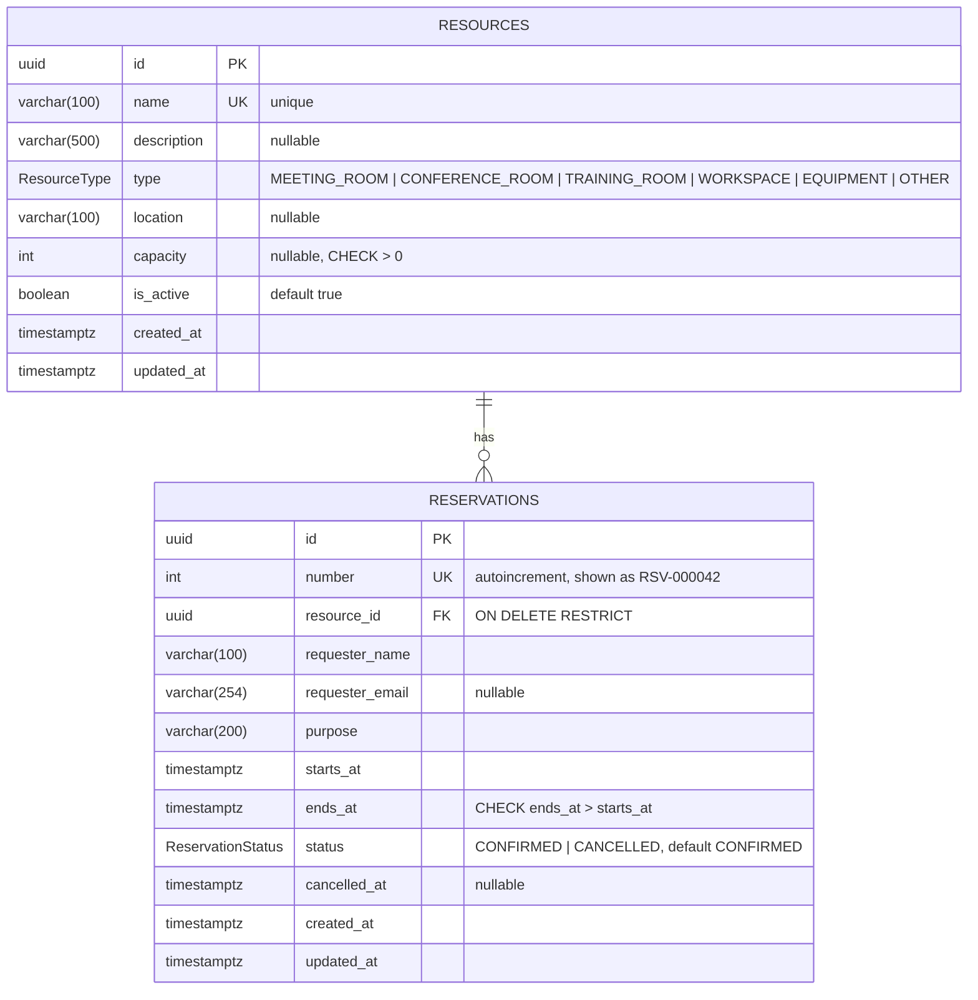

# Entity-Relationship Diagram

This diagram matches [`prisma/schema.prisma`](../prisma/schema.prisma) and the SQL migrations in
[`prisma/migrations`](../prisma/migrations). There is no `User` table: the application has no
authentication, so each reservation stores the requester's name and optional email directly.



## Relationship

- One **resource** has zero or more **reservations**. Each reservation belongs to exactly one resource
  (`reservations.resource_id → resources.id`).
- `ON DELETE RESTRICT` means a resource with reservations can't be deleted. Resources are deactivated
  (`is_active = false`) instead, so booking history is kept.

## Constraints and indexes

| Name | Type | Definition |
|---|---|---|
| `resources_pkey` / `reservations_pkey` | Primary key | `id` (UUID) |
| `resources_name_key` | Unique | `name` |
| `reservations_number_key` | Unique | `number` |
| `reservations_resource_id_fkey` | Foreign key | `resource_id → resources(id)` restrict on delete |
| `resources_capacity_positive` | CHECK | `capacity IS NULL OR capacity > 0` |
| `reservations_valid_range` | CHECK | `ends_at > starts_at` |
| `reservations_no_overlap` | EXCLUDE (GiST, `btree_gist`) | `(resource_id WITH =, tstzrange(starts_at, ends_at, '[)') WITH &&) WHERE (status = 'CONFIRMED')` |
| Indexes | B-tree | `resources(type)`, `resources(is_active)`, `reservations(resource_id, starts_at)`, `reservations(starts_at)`, `reservations(status, starts_at)`, `reservations(updated_at)` |

## Shareable link

**Published diagram:** <https://drive.google.com/file/d/16ZCnLvu152ZG6VtkMVU80GUA5OLiEudE/view?usp=sharing>

The source is [`er-diagram.drawio`](er-diagram.drawio), which you can open at <https://app.diagrams.net>.

## Publishing or updating the link

To update the published copy without changing the link: in Google Drive, right-click the file,
choose **File information → Manage versions → Upload new version**, and select `docs/er-diagram.drawio`.
Alternatively, publish it through one of these services:

**Option A: Mermaid Live Editor**
1. Open <https://mermaid.live>.
2. Paste the contents of the ` ```mermaid ` block above into the code panel.
3. Click **Share**, then copy the generated link (or use **Actions → PNG/SVG** to export an image).

**Option B: dbdiagram.io**
1. Open <https://dbdiagram.io/d> and sign in.
2. Replace the editor contents with [`docs/schema.dbml`](schema.dbml).
3. Click **Share**, set the visibility to *Anyone with the link can view*, and copy the URL.

Paste the link into the README's "Database design" section before you submit.
